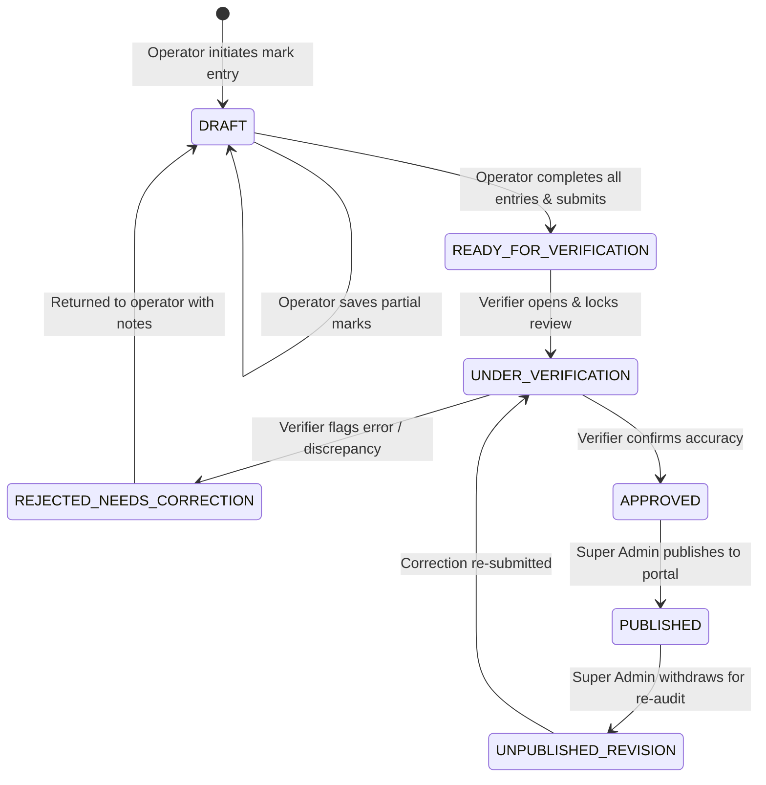

# BUSINESS LOGIC & CALCULATION ENGINE SPECIFICATION
## Modern Festival Result Management System

### 1. Core Principles of the Result Engine

1. **Configurable Scoring & Grading**: Different categories and festivals can customize position points, grade thresholds, and tie policies without altering backend code.
2. **Determinism & Reproducibility**: Given an identical set of judge marks and program parameters, the engine always yields the exact same ranked positions, grades, and point awards.
3. **Immutability of Published Results**: A published result can never be silently overwritten or modified by recalculation. A formal withdrawal or correction workflow with an audit trail is strictly enforced.
4. **Separation of Individual vs. Institution Points**: Participant standings (Positions & Grades) are distinct from Institution Championship points, supporting both individual accolades and institutional tallying.

---

### 2. Mark Evaluation & Score Aggregation

For any program item with $N$ judges (typically $N = 3$) and maximum mark $M_{max}$ (typically $100$ per judge):

#### Individual Judge Score Validation
$$0 \le M_{j} \le M_{max} \quad \forall j \in \{1, \dots, N\}$$
Any non-numeric value or mark exceeding $M_{max}$ is blocked at the validation layer.

#### Aggregation Methods
1. **Average Scoring (Standard / Default)**:
   $$S_{final} = \frac{\sum_{j=1}^{N} M_{j}}{N}$$
   $$P_{final} = \left(\frac{S_{final}}{M_{max}}\right) \times 100\%$$
2. **Total Mark Sum**:
   $$S_{final} = \sum_{j=1}^{N} M_{j}$$
   $$P_{final} = \left(\frac{S_{final}}{N \times M_{max}}\right) \times 100\%$$
3. **Drop High/Low (Olympic Style)**:
   Used when $N \ge 3$ judges:
   $$S_{final} = \frac{\sum_{j=1}^{N} M_{j} - \min(M) - \max(M)}{N - 2}$$

---

### 3. Grade Allocation Rules

Grades are evaluated directly on the calculated final percentage $P_{final}$ based on the standard Sahodaya & State Festival standards (configurable per program):

| Grade | Percentage Threshold ($P_{final}$) | Typical Individual Event Points | Typical Group Event Points | Qualifying Description |
|---|---|---|---|---|
| **A** | $70.00\% \le P_{final} \le 100\%$ | 5 points | 10 points | Outstanding performance meeting excellence criteria |
| **B** | $60.00\% \le P_{final} < 70.00\%$ | 3 points | 6 points | Very good performance |
| **C** | $50.00\% \le P_{final} < 60.00\%$ | 1 point | 2 points | Good performance meeting basic standards |
| **No Grade** | $P_{final} < 50.00\%$ | 0 points | 0 points | Below minimum grade boundary |

*Special Cases:*
- **Absent (`ABSENT`)**: Score = 0, Grade = None, Points = 0, Position = None.
- **Disqualified (`DISQUALIFIED`)**: Score = 0, Grade = None, Points = 0, Position = Disqualified (reason logged).
- **Withheld (`WITHHELD`)**: Marks retained internally, excluded from public tally until released by verifier.

---

### 4. Position Allocation & Tie Handling

After calculating $S_{final}$ for all active entries, contestants are sorted in descending order of $S_{final}$.

#### Position Ranking Rules
- **1st Position**: Awarded to the highest scoring entry/entries.
- **2nd Position**: Awarded to the next distinct score tier.
- **3rd Position**: Awarded to the third distinct score tier.

#### Standard Position Points Table

| Item Type | 1st Position | 2nd Position | 3rd Position | Grade A | Grade B | Grade C |
|---|---|---|---|---|---|---|
| **Individual Event** | 5 | 3 | 1 | 5 | 3 | 1 |
| **Group Event** | 10 | 6 | 2 | 10 | 6 | 2 |

*(Note: In festival rules where points are combined or non-cumulative, the policy flag `pointsMode` defines whether an entry receives `Position Points + Grade Points` or `MAX(Position Points, Grade Points)` or `Only Position Points`). The system supports these via an explicit program-level toggle.*

#### Tie-Breaking Policies

1. **Shared Position (Standard Festival Policy)**:
   - If two contestants tie for 1st place ($S_1 = S_2$), **both receive 1st position** and full 1st position points.
   - The subsequent contestant receives **2nd position** (or 3rd depending on the festival's skip-rank policy `dense_rank` vs `rank`).
   - Default: Dense ranking (`1st, 1st, 2nd, 3rd`) ensures participants receive their earned honors.
2. **Split Points Policy**:
   - If two participants tie for 1st place, $(Points_{1st} + Points_{2nd}) / 2$ is shared equally.
3. **Manual Tie-Breaker**:
   - If marks tie, the Chief Judge can upload a tie-breaker criterion (e.g. Higher score in Sub-Criteria A: Rhythm/Tala, or toss/jury review) directly documented in the audit log.

---

### 5. Institution Championship Points & Leaderboard Calculation

Whenever a program's result reaches `PUBLISHED` status:

#### Institution Aggregation Formula
For each institution $I$ in festival $F$:
$$TotalPoints(I) = \sum_{p \in PublishedPrograms} \left( \sum_{e \in Entries(I, p)} TotalPoints(e) \right)$$

Where:
- $FirstCount(I) = \text{Count of entries from } I \text{ securing 1st Position}$
- $SecondCount(I) = \text{Count of entries from } I \text{ securing 2nd Position}$
- $ThirdCount(I) = \text{Count of entries from } I \text{ securing 3rd Position}$
- $GradeACount(I) = \text{Count of entries from } I \text{ achieving Grade A}$

#### Championship Tie-Breaker Hierarchy
If two institutions tie on total accumulated points:
1. Higher count of **1st Positions**
2. Higher count of **2nd Positions**
3. Higher count of **3rd Positions**
4. Higher count of **Grade A** awards
5. Joint Trophy / Shared Championship

---

### 6. Result Lifecycle & Verification State Machine

1. **DRAFT**:
   - Mark entry operator enters marks per judge.
   - Autosave enabled; incomplete sheets allowed.
   - Public cannot see any data.
2. **READY_FOR_VERIFICATION (SUBMITTED)**:
   - Validates that every registered entry has either complete valid marks from all assigned judges or is marked `ABSENT` / `DISQUALIFIED`.
   - Sheet is frozen from casual edits.
3. **UNDER_VERIFICATION**:
   - Verification officer reviews the digital mark sheet alongside physical score sheets signed by judges.
   - Highlights any outliers, ties, or discrepancies.
4. **APPROVED**:
   - Scores verified and mathematically validated.
   - Ready for official release.
5. **PUBLISHED**:
   - Immediately visible on the public website and mobile portal.
   - Instantly updates the live Championship Leaderboard.
   - Generates official signed PDF result documents.

