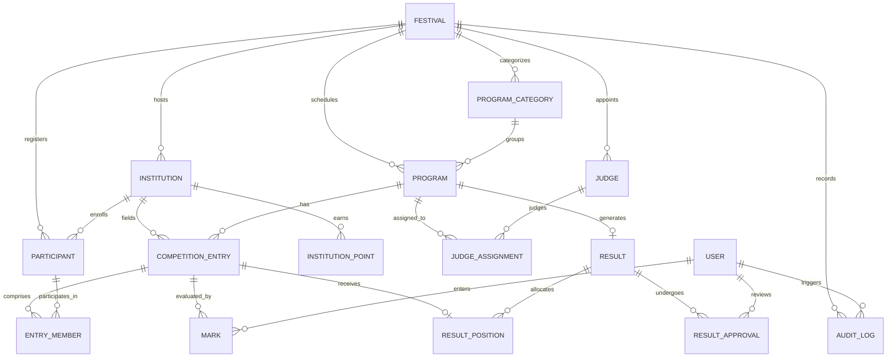

# DATABASE STRUCTURE SPECIFICATION
## Modern Festival Result Management System

### 1. Architectural Overview & Design Principles

The database is designed with third-normal-form (3NF) relational architecture, ensuring:
- **Strict Data Integrity & Idempotency**: Unique constraints on registration numbers, program codes, and competition entries.
- **Multi-Tenant Isolation by Festival**: Every core operational table partitions data by `festivalId` to guarantee that multi-year or multiple concurrent festival events operate completely independently without cross-contamination.
- **Auditability & Traceability**: Full transaction histories, status transitions, and audit logs tracking user operations.
- **Optimized for High-Throughput Mark Entry**: Flat and index-optimized relational structures enabling sub-10ms reads and bulk write performance during intensive live festival mark evaluations.

---

### 2. Entity-Relationship Diagram (Mermaid)

---

### 3. Detailed Schema Specification

#### 3.1 Users & Authentication (`users`)
Manages administrative users, program admins, judges, and verification officers.

| Column | Type | Constraints | Description |
|---|---|---|---|
| `id` | VARCHAR(36) | PRIMARY KEY, UUID | Unique user identifier |
| `name` | VARCHAR(255) | NOT NULL | Full name of the user |
| `email` | VARCHAR(255) | NOT NULL, UNIQUE | User email for login |
| `username` | VARCHAR(100) | UNIQUE | Optional username for fast kiosk login |
| `passwordHash` | VARCHAR(255) | NOT NULL | Argon2id / bcrypt salted hash |
| `role` | ENUM | NOT NULL | `SUPER_ADMIN`, `PROGRAM_ADMIN`, `JUDGE`, `VERIFIER` |
| `phone` | VARCHAR(50) | NULLABLE | Contact phone number |
| `isActive` | BOOLEAN | DEFAULT true | Account status switch |
| `createdAt` | TIMESTAMP | DEFAULT CURRENT_TIMESTAMP | Record creation timestamp |
| `updatedAt` | TIMESTAMP | AUTO-UPDATE | Record modification timestamp |

#### 3.2 Festivals (`festivals`)
Top-level multi-festival tenant boundary.

| Column | Type | Constraints | Description |
|---|---|---|---|
| `id` | VARCHAR(36) | PRIMARY KEY, UUID | Unique festival ID |
| `name` | VARCHAR(255) | NOT NULL | E.g. "Sahodaya Kalotsav 2026" |
| `code` | VARCHAR(50) | NOT NULL, UNIQUE | URL slug / short code (e.g. `SK2026`) |
| `year` | INT | NOT NULL | Festival year (e.g. `2026`) |
| `startDate` | DATE | NOT NULL | Event commencement date |
| `endDate` | DATE | NOT NULL | Event culmination date |
| `venue` | VARCHAR(255) | NOT NULL | Main venue / campus location |
| `description` | TEXT | NULLABLE | Summary and details |
| `logoUrl` | VARCHAR(500) | NULLABLE | Branding logo URL / path |
| `status` | ENUM | DEFAULT 'UPCOMING' | `UPCOMING`, `ACTIVE`, `COMPLETED`, `ARCHIVED` |
| `isPublished` | BOOLEAN | DEFAULT false | Global flag for public portal visibility |
| `createdAt` | TIMESTAMP | DEFAULT CURRENT_TIMESTAMP | |
| `updatedAt` | TIMESTAMP | AUTO-UPDATE | |

#### 3.3 Institutions (`institutions`)
Participating schools, colleges, or houses.

| Column | Type | Constraints | Description |
|---|---|---|---|
| `id` | VARCHAR(36) | PRIMARY KEY, UUID | Unique institution ID |
| `festivalId` | VARCHAR(36) | FOREIGN KEY -> festivals(id) | Associated festival |
| `name` | VARCHAR(255) | NOT NULL | Institution full name |
| `code` | VARCHAR(50) | NOT NULL | Short code (e.g. `SCH-101`) |
| `district` | VARCHAR(100) | NULLABLE | District / region |
| `category` | VARCHAR(100) | NULLABLE | E.g. `Senior Secondary`, `High School` |
| `contactPerson`| VARCHAR(150) | NULLABLE | Team manager name |
| `contactEmail` | VARCHAR(255) | NULLABLE | Communication email |
| `contactPhone` | VARCHAR(50) | NULLABLE | Phone number |
| `createdAt` | TIMESTAMP | DEFAULT CURRENT_TIMESTAMP | |
| `updatedAt` | TIMESTAMP | AUTO-UPDATE | |

*Index: `UNIQUE(festivalId, code)` ensures code uniqueness per festival.*

#### 3.4 Participants (`participants`)
Individual registered candidates.

| Column | Type | Constraints | Description |
|---|---|---|---|
| `id` | VARCHAR(36) | PRIMARY KEY, UUID | Unique participant ID |
| `festivalId` | VARCHAR(36) | FOREIGN KEY -> festivals(id) | Associated festival |
| `institutionId`| VARCHAR(36) | FOREIGN KEY -> institutions(id)| Enrolled institution |
| `registrationNo`| VARCHAR(100)| NOT NULL | Unique student registration code |
| `name` | VARCHAR(255) | NOT NULL | Full name of student |
| `category` | VARCHAR(100) | NOT NULL | E.g. `Sub-Junior`, `Junior`, `Senior` |
| `gradeClass` | VARCHAR(50) | NULLABLE | Class / Standard (e.g. `Class 10`) |
| `gender` | VARCHAR(20) | NULLABLE | `Male`, `Female`, `Other` |
| `createdAt` | TIMESTAMP | DEFAULT CURRENT_TIMESTAMP | |
| `updatedAt` | TIMESTAMP | AUTO-UPDATE | |

*Index: `UNIQUE(festivalId, registrationNo)` ensures unique candidate IDs per festival.*

#### 3.5 Program Categories (`program_categories`)
Logical taxonomy (e.g. *Stage Arts, Literary, Music, Dance, Fine Arts*).

| Column | Type | Constraints | Description |
|---|---|---|---|
| `id` | VARCHAR(36) | PRIMARY KEY, UUID | Category ID |
| `festivalId` | VARCHAR(36) | FOREIGN KEY -> festivals(id) | Associated festival |
| `name` | VARCHAR(150) | NOT NULL | E.g. "Classical Dance", "Literary" |
| `code` | VARCHAR(50) | NOT NULL | Category shorthand |
| `sortOrder` | INT | DEFAULT 0 | Display priority |

#### 3.6 Programs / Competitions (`programs`)
Definition of each contest item.

| Column | Type | Constraints | Description |
|---|---|---|---|
| `id` | VARCHAR(36) | PRIMARY KEY, UUID | Program ID |
| `festivalId` | VARCHAR(36) | FOREIGN KEY -> festivals(id) | Associated festival |
| `categoryId` | VARCHAR(36) | FOREIGN KEY -> program_categories(id) | Associated category |
| `name` | VARCHAR(255) | NOT NULL | E.g. "Mohiniyattam", "English Elocution" |
| `code` | VARCHAR(50) | NOT NULL | Competition code (e.g. `PROG-201`) |
| `type` | ENUM | NOT NULL | `INDIVIDUAL`, `GROUP` |
| `section` | VARCHAR(100) | NOT NULL | E.g. `Category 3 (Classes 8-10)` |
| `maxMarks` | DECIMAL(5,2)| DEFAULT 100.00 | Maximum mark threshold per judge |
| `judgeCount` | INT | DEFAULT 3 | Expected number of judges (1 to 5) |
| `scoringMethod`| ENUM | DEFAULT 'AVERAGE' | `AVERAGE`, `TOTAL`, `DROP_HIGH_LOW` |
| `status` | ENUM | DEFAULT 'SCHEDULED' | `SCHEDULED`, `READY_FOR_MARKS`, `MARKS_ENTERED`, `UNDER_VERIFICATION`, `APPROVED`, `PUBLISHED` |
| `positionPoints`| JSONB / TEXT| NOT NULL | Points map: `{"1": 10, "2": 7, "3": 5}` |
| `gradeBoundaries`| JSONB / TEXT| NOT NULL | Grade tiers: `[{"grade":"A","minPercentage":70,"points":5}, ...]` |
| `tiePolicy` | ENUM | DEFAULT 'SHARED' | `SHARED`, `SPLIT`, `MANUAL` |
| `createdAt` | TIMESTAMP | DEFAULT CURRENT_TIMESTAMP | |
| `updatedAt` | TIMESTAMP | AUTO-UPDATE | |

*Index: `UNIQUE(festivalId, code)` ensures code uniqueness per festival.*

#### 3.7 Competition Entries (`competition_entries`)
Specific contestant slots in a program, supporting both individual candidates and groups.

| Column | Type | Constraints | Description |
|---|---|---|---|
| `id` | VARCHAR(36) | PRIMARY KEY, UUID | Unique Entry ID |
| `programId` | VARCHAR(36) | FOREIGN KEY -> programs(id) | Program contest |
| `institutionId`| VARCHAR(36) | FOREIGN KEY -> institutions(id)| Represented institution |
| `chestNo` | VARCHAR(50) | NOT NULL | Secret or visible performance code |
| `groupName` | VARCHAR(150) | NULLABLE | Name of troop (for group events) |
| `status` | ENUM | DEFAULT 'REGISTERED' | `REGISTERED`, `PERFORMED`, `ABSENT`, `DISQUALIFIED`, `WITHHELD` |
| `createdAt` | TIMESTAMP | DEFAULT CURRENT_TIMESTAMP | |

*Index: `UNIQUE(programId, chestNo)` prevents duplicate chest numbers within a program.*

#### 3.8 Entry Members (`entry_members`)
Associates 1 or more participants with a competition entry (handles group items cleanly).

| Column | Type | Constraints | Description |
|---|---|---|---|
| `id` | VARCHAR(36) | PRIMARY KEY, UUID | Association ID |
| `entryId` | VARCHAR(36) | FOREIGN KEY -> competition_entries(id) ON DELETE CASCADE | Target entry |
| `participantId`| VARCHAR(36) | FOREIGN KEY -> participants(id) ON DELETE CASCADE | Associated student |
| `isLeader` | BOOLEAN | DEFAULT false | Group captain designation |

#### 3.9 Judges & Assignments (`judges`, `judge_assignments`)
Tracks assigned adjudicators.

`judges`:
- `id` (PK, UUID)
- `festivalId` (FK)
- `name` (VARCHAR)
- `judgeCode` (VARCHAR, UNIQUE)
- `phone` (VARCHAR)
- `specialization` (VARCHAR)

`judge_assignments`:
- `id` (PK, UUID)
- `programId` (FK -> programs)
- `judgeId` (FK -> judges)
- `judgeIndex` (INT: 1, 2, 3...) — identifies Judge 1, Judge 2, Judge 3 in mark entry grids.

#### 3.10 Marks (`marks`)
Raw score entry per entry per judge.

| Column | Type | Constraints | Description |
|---|---|---|---|
| `id` | VARCHAR(36) | PRIMARY KEY, UUID | Mark ID |
| `entryId` | VARCHAR(36) | FOREIGN KEY -> competition_entries(id) | Evaluated entry |
| `judgeIndex` | INT | NOT NULL | Judge number (1, 2, 3) |
| `mark` | DECIMAL(5,2)| NOT NULL | Entered score |
| `criteriaScores`| JSONB / TEXT| NULLABLE | Optional breakdown (Technique, Expression, etc.) |
| `remarks` | TEXT | NULLABLE | Judge comments |
| `isDraft` | BOOLEAN | DEFAULT false | Allows saving progress |
| `enteredByUserId`| VARCHAR(36)| FOREIGN KEY -> users(id) | Operator who entered the mark |
| `createdAt` | TIMESTAMP | DEFAULT CURRENT_TIMESTAMP | |
| `updatedAt` | TIMESTAMP | AUTO-UPDATE | |

*Index: `UNIQUE(entryId, judgeIndex)` ensures 1 score per judge slot.*

#### 3.11 Results & Positions (`results`, `result_positions`)
Calculated, verified, and published outcomes.

`results`:
- `id` (PK, UUID)
- `programId` (FK -> programs, UNIQUE)
- `status` (ENUM: `DRAFT`, `SUBMITTED`, `UNDER_VERIFICATION`, `APPROVED`, `PUBLISHED`)
- `calculatedAt` (TIMESTAMP)
- `verifiedByUserId` (FK -> users, NULLABLE)
- `verifiedAt` (TIMESTAMP, NULLABLE)
- `publishedAt` (TIMESTAMP, NULLABLE)
- `notes` (TEXT, NULLABLE)

`result_positions`:
- `id` (PK, UUID)
- `resultId` (FK -> results ON DELETE CASCADE)
- `entryId` (FK -> competition_entries)
- `totalScore` (DECIMAL(6,2)) — sum of all judge marks
- `finalScore` (DECIMAL(6,2)) — average or adjusted score
- `percentage` (DECIMAL(5,2)) — final score as % of max marks
- `rank` (INT) — numerical rank (1, 2, 3, 4...)
- `position` (VARCHAR) — "1st", "2nd", "3rd", or "None"
- `grade` (VARCHAR) — "A", "B", "C", or "None"
- `positionPoints` (DECIMAL(5,2)) — Points awarded for 1st/2nd/3rd
- `gradePoints` (DECIMAL(5,2)) — Points awarded for Grade A/B/C
- `totalPoints` (DECIMAL(5,2)) — positionPoints + gradePoints
- `isTied` (BOOLEAN) — True if tied with another entry
- `status` (VARCHAR) — "NORMAL", "ABSENT", "DISQUALIFIED", "WITHHELD"

#### 3.12 Institution Points & Leaderboard (`institution_points`)
Real-time materialized aggregation table for the live championship standing.

| Column | Type | Constraints | Description |
|---|---|---|---|
| `id` | VARCHAR(36) | PRIMARY KEY, UUID | Summary ID |
| `festivalId` | VARCHAR(36) | FOREIGN KEY -> festivals(id) | Target festival |
| `institutionId`| VARCHAR(36) | FOREIGN KEY -> institutions(id)| Target institution |
| `totalPoints` | DECIMAL(8,2)| DEFAULT 0.00 | Aggregated points |
| `firstCount` | INT | DEFAULT 0 | Count of 1st places |
| `secondCount`| INT | DEFAULT 0 | Count of 2nd places |
| `thirdCount` | INT | DEFAULT 0 | Count of 3rd places |
| `gradeACount` | INT | DEFAULT 0 | Count of Grade A performances |
| `rank` | INT | DEFAULT 0 | Current championship ranking |
| `updatedAt` | TIMESTAMP | AUTO-UPDATE | Timestamp of last recalculation |

*Index: `UNIQUE(festivalId, institutionId)`*

#### 3.13 Audit Logs (`audit_logs`)
Complete forensic record of every action across the system.

- `id` (PK, UUID)
- `userId` (FK -> users, NULLABLE)
- `festivalId` (FK -> festivals, NULLABLE)
- `action` (VARCHAR: `MARK_SAVED`, `RESULT_CALCULATED`, `RESULT_VERIFIED`, `RESULT_PUBLISHED`, etc.)
- `entityType` (VARCHAR: `PROGRAM`, `MARK`, `ENTRY`, etc.)
- `entityId` (VARCHAR: ID of target)
- `payload` (JSONB / TEXT: Before/after snapshots)
- `ipAddress` (VARCHAR)
- `createdAt` (TIMESTAMP)

