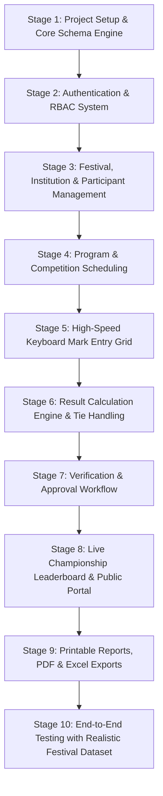

# IMPLEMENTATION PLAN & ARCHITECTURE EVALUATION
## Modern Festival Result Management System

### 1. Architecture Comparison & Recommendation

The user specification presents two architectural approaches for transforming the result management workflow:

| Evaluation Dimension | Option A: Google Ecosystem (Sheets + Apps Script API + React) | Option B: Modern Database Architecture (PostgreSQL / SQLite + Prisma + Next.js Fullstack) |
|---|---|---|
| **Performance** | High latency (Apps Script executions take 1.5s - 5s per call; Google Sheet read/write rate quotas choke under simultaneous judge mark entry). | Sub-10ms response times. In-memory connection pooling, local disk / fast database queries, instant keyboard mark-entry. |
| **Scalability** | Severe Google Workspace rate limits (max 30-100 read/write requests/min per user/script). Hard limit of 10 million cells in Sheets. Fails under festival peak load with dozens of simultaneous operators. | Easily handles tens of thousands of participants, hundreds of programs, millions of score entries with zero throttling. |
| **Data Integrity & Concurrency** | Prone to race conditions and overwrites during concurrent cell edits. Lack of transactional ACID guarantees across multiple sheets. | True ACID transactions. Foreign keys, check constraints, unique constraints, and atomic row-level locks preventing race conditions. |
| **Security & Access Control** | Fragile link-based or email permissions; exposing Google Sheet formulas risks accidental modification or data leakage. | Industrial RBAC with bcrypt/Argon2 password hashing, secure HTTP-only session cookies, parameterized SQL queries preventing injection, complete audit logs. |
| **Maintenance & Developer Experience** | Debugging Apps Script is notoriously slow and difficult. Fragile formula references break when column headers or rows move. | Type-safe end-to-end TypeScript, Prisma ORM schema migrations, modular React components, standard automated testing. |
| **Cost & Independence** | Dependent on Google infrastructure, quota tiers, and potential Google Workspace account limitations. | Zero vendor lock-in. Self-hostable on any VPS, cloud server (AWS, GCP, DigitalOcean), or local intranet server with zero ongoing license costs. |

#### Architectural Recommendation
**Strongly Recommend Option B (Modern Database Architecture with Next.js, Prisma ORM, and TypeScript).**

*Key Rationale:*
During live festivals (such as Sahodaya Kalotsav or State Youth Festivals), score-entry operators and judges evaluate hundreds of participants concurrently under extreme time constraints. Relying on Google Sheets introduces rate-limiting blocks, script timeout errors (6-minute Apps Script limit), and latency that frustrates operators. A unified Next.js + Prisma full-stack application provides the lightning-fast responsiveness of desktop software with the accessibility and real-time public reach of a modern web application.

---

### 2. Implementation Roadmap (Phases & Deliverables)

#### Stage 1: Foundation & Prisma Schema
- Initialize Next.js 14/15 with TypeScript, Tailwind CSS, Lucide Icons, and shadcn/ui components.
- Configure Prisma with SQLite for rapid zero-configuration development and deployment, fully compatible with PostgreSQL via standard Prisma datasource swap.
- Generate Prisma client and seed script.

#### Stage 2: Authentication & Security
- Secure session management with HTTP-only cookies.
- Role-based authorization middleware guarding `/admin/*` and API routes.
- Seed default accounts: Super Admin, Program Admin, Judge, Verification Officer.

#### Stage 3: Institution & Participant Registry
- CRUD operations with instant search, filtering by district/category.
- Excel/CSV bulk import parser for institutions and participants.
- Duplicate detection on registration numbers.

#### Stage 4: Program / Competition Registry
- Program configuration: categories, individual vs group, judge count, max marks.
- Configurable scoring rules (average, total), position points (1st/2nd/3rd), and grade boundaries (A/B/C).
- Registration of entries (chest numbers and candidate linkages).

#### Stage 5: Desktop-Optimized Spreadsheet Mark Entry
- Keyboard-first data grid (`Tab`, `Enter`, `Arrows`).
- Instant client-side validation and autosave.
- Judge-by-judge input cells with total and average computation.
- Status toggle: Present, Absent, Disqualified, Withheld.

#### Stage 6: Calculation Engine
- Core calculation logic implementing all business rules from `docs/BUSINESS_LOGIC.md`.
- Automated ranking, grade allocation, tie detection.
- Materialized institution points accumulator.

#### Stage 7: Verification & Publication
- Multi-step workflow: `DRAFT` $\to$ `SUBMITTED` $\to$ `UNDER_VERIFICATION` $\to$ `APPROVED` $\to$ `PUBLISHED`.
- Audit logs capturing all approval/rejection actions and comments.

#### Stage 8: Public Results Portal & Live Leaderboard
- Mobile-first public search by student name, chest number, school, and program.
- Live championship points leaderboard with podium display for top 3 institutions.
- Category-wise and program-wise result views.

#### Stage 9: Reports & Export Engine
- Professional print layouts (clean typography, festival header, official stamp & signature lines).
- CSV / Excel export for complete festival master records.

#### Stage 10: Verification & Testing
- Load complete realistic festival dataset (e.g. Sahodaya Arts Festival with 5 schools, 10 programs, 100+ participants, multiple judges).
- Verify mark entry, tie breaking, grade allocation, institution points tallying, and public views.

