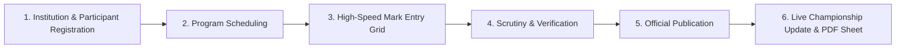

# USER & OPERATOR MANUAL
## Modern Festival Result Management System

### 1. Default Role Accounts & Credentials

The system comes pre-configured with dedicated accounts for each tier:

| Role | Username / Email | Password | Scope of Authority |
|---|---|---|---|
| **Super Administrator** | `admin@festival.org` (or `superadmin`) | `admin123` | Complete system access: Festival setup, user accounts, publish results, system config. |
| **Program Administrator** | `program@festival.org` (or `progadmin`) | `program123` | Event scheduling, participant management, reports export. |
| **Judge / Operator** | `judge@festival.org` (or `judge01`) | `judge123` | High-speed mark entry grid, draft saves, submission to scrutiny. |
| **Verification Officer** | `verifier@festival.org` (or `verifier01`) | `verifier123` | Score sheet scrutiny, discrepancy checks, result approval/rejection. |
| **Public Visitor** | *(No credentials required)* | *N/A* | Browse published results, view live championship leaderboard, print public certificates. |

---

### 2. Operational Workflow Step-by-Step

#### Step 1: Institution & Candidate Registration
1. Log in as **Super Administrator** or **Program Administrator**.
2. Navigate to **Institutions**:
   - Add participating schools individually or export the Excel template and bulk import via CSV.
3. Navigate to **Participants**:
   - Register students with unique Registration Numbers, Section (Sub-Junior, Junior, Senior), and School assignment.

#### Step 2: Program & Competition Setup
1. Open **Programs & Events**:
   - Create competition items (e.g. Bharatanatyam, English Elocution, Folk Dance Group).
   - Configure Category, Section, Maximum Marks (e.g. 100), and Number of Judges (1 to 5).
   - Scoring Mode defaults to `AVERAGE` (or `TOTAL` / `DROP_HIGH_LOW`).
   - Position Points default to: `1st: 5 pts`, `2nd: 3 pts`, `3rd: 1 pt` (Group events: `10, 6, 2`).
   - Grade boundaries default to: `A >= 70%`, `B >= 60%`, `C >= 50%`.

#### Step 3: Keyboard-First Mark Entry
1. Log in as **Judge / Mark Entry Operator**.
2. Click **Mark Entry Grid** from the sidebar and select the active program.
3. **Keyboard Shortcuts for High-Volume Entry**:
   - **`Enter` or `↓` (Arrow Down)**: Submits cell and moves focus to the same judge for the next contestant.
   - **`Tab` or `→` (Arrow Right)**: Moves focus to the next judge's mark for the same contestant.
   - **`↑` (Arrow Up)**: Moves focus to the previous row.
   - **`Ctrl+S` (or Cmd+S)**: Instantly saves a draft without reloading the page.
4. **Mark Validation**:
   - If an entered mark exceeds the maximum allowable mark (e.g. typing `105` when max is `100`), the cell highlights red and blocks invalid submission.
5. **Marking Absentees**:
   - Change contestant status dropdown to `Absent` or `Disqualified`. The row is automatically excluded from medal ranking.
6. When all entries are entered, click **Submit for Verification**.

#### Step 4: Result Verification & Scrutiny
1. Log in as **Verification Officer** (or Super Admin).
2. Navigate to **Result Verification**:
   - Select the submitted program from the verification queue.
   - Review the calculated table: compare Judge 1, Judge 2, and Judge 3 scores side-by-side with physical judge sheets.
   - Preview calculated Positions (1st, 2nd, 3rd) and Grades (A, B, C).
3. **Actions**:
   - **Approve Result**: If marks and calculations are verified, click `Approve Result`.
   - **Return for Correction**: If an operator made a typo or entered an incorrect score, type an explanation in the notes box and click `Return for Correction`. The program returns to Draft status for the operator to adjust.

#### Step 5: Official Result Publication
1. Log in as **Super Administrator**.
2. From **Result Verification**, click **Publish to Portal**:
   - The result is immediately published on the public portal and mobile website.
   - The **Overall Championship Leaderboard** is atomically updated in real-time, adding position and grade points to the participating institutions.
   - Official certified PDF result sheets are immediately available for download or printing.

#### Step 6: Public Results & Leaderboard Access
- Visitors can access the public portal at any time without logging in:
  - **Live Leaderboard (`/leaderboard`)**: Real-time school podium (Gold, Silver, Bronze) with point breakdown.
  - **Search (`/search`)**: Instant lookup by student name, chest number, registration number, or school name.
  - **Program Result (`/results/[id]`)**: Full official sheet with ranks, grades, and candidate details.

